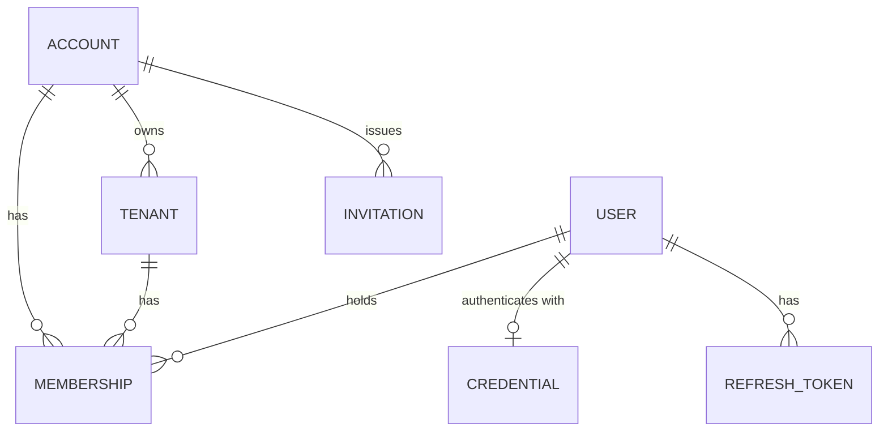

# Axioma Life: Account Service (draft foundations)

> Status: **DRAFT**. The object model is decided (GP-4, see "Decisions"). Everything marked
> "Proposed" is still a starting point to be challenged in GP-4. Axioma Life is fictitious; its
> purpose is to practice multi-tenant SaaS patterns in Go.

## Product context

**Axioma Life** is a fictitious Human Resources and Payroll SaaS for the Mexican market. It is
multi-tenant: many employers use the same platform, with their data isolated from each other.

This document covers only the foundation every other service depends on: who the customers are,
how their organizations (tenants) are modelled, and who can do what. HR and payroll features come
later.

## Decisions (GP-4)

Resolves Q1 to Q12 and Q16 (added during GP-4) of the original draft.

1. **Customer is merged into Account.** Account is the customer, the billing container and the
   ownership boundary (billing info, plan, status). Split Customer out only if one buyer ever needs
   several accounts (revisits Q5). Subscription/plan stays as fields on Account for now.
2. **User is a global identity** (unique email), not owned by any tenant. Access is granted only through
   **Membership** (user + scope + role), so one person can belong to several tenants (Q3).
3. **Signup creates the Account only.** The first Tenant is a separate step.
4. **SuperUser is dropped.** The **owner** is the root user who signs up (Q4). A platform operator
   (Axioma staff) is a separate concern and out of scope for now.
5. **An account admin manages all tenants of the account** without a membership in each (Q6).
6. **Naming and persistence conventions** (Q16): plain names namespaced by Go package; plural
   snake_case tables in per-module Postgres schemas.
7. **Isolation strategy** (Q1): shared tables with a `tenant_id` column plus PostgreSQL Row-Level
   Security. The app connects as a role that is not the table owner and has no `BYPASSRLS`; each
   request sets `SET LOCAL app.tenant_id = ...` inside a transaction so pooled connections cannot
   leak the setting.
8. **Tenant resolution** (Q2): a tenant-scoped token (`tenant_id` claim) is the source of truth, and
   the tenant id also appears in the path (`/v1/tenants/{tenant_id}/...`). Middleware rejects
   requests where the two differ. Account-level calls (signup, `/v1/account`, tenant list) use an
   account-scoped token with no tenant claim. Token lifetime and revocation stay in Q8.
9. **RLS scope** (Q1): only tenant-scoped data carries `tenant_id` and RLS (future HR and payroll
   tables). Account-level tables (`accounts`, `users`, `credentials`, `refresh_tokens`) are not
   tenant-scoped. `tenants` and `memberships` are read before a tenant is chosen, so they have no
   RLS and are queried explicitly by account or user. Provisional until the plan phase.
10. **Auth approach** (Q7): build our own first (password hashing with argon2id or bcrypt, JWT,
    refresh tokens) behind an interface for issuing and verifying tokens, so an external provider
    such as Cognito can replace it later.
11. **Token design** (Q8): access token is a short-lived JWT (about 15 minutes) signed with an
    asymmetric key (EdDSA or RS256), with claims `sub`, `account_id`, `tenant_id` (tenant-scoped
    tokens only), `roles`, `iat`, `exp`, `iss`, `aud`. Refresh token is an opaque random string
    stored hashed in `refresh_tokens`, rotated on every use; reuse of an old one revokes the whole
    token family. Two token types: account-scoped after login, tenant-scoped after selecting a
    tenant (see decision 8). Only refresh tokens are revocable; access tokens expire, so role
    changes take effect within the access token lifetime.
12. **Authorization model** (Q9): simple RBAC with static roles defined in code, mapped to
    permissions in a single Go file. Handlers check a permission (for example
    `tenant.invite_user`), never a role name. Account-scope roles imply access to all tenants of the
    account (decision 5).
13. **Tenant lifecycle** (Q10): states `active`, `suspended` and `pending_deletion`. Suspended
    tenants keep their data but get no tenant-scoped tokens, and reads and writes are refused.
    Delete is a soft delete to `pending_deletion`, restorable for 30 days (placeholder), then a purge
    job hard-deletes. A suspended account suspends its tenants, derived from account status rather
    than written to each tenant. Legal retention periods for payroll data belong to the HR domain.
    Demo-account expiry is noted but not built.
14. **Plan limits** (Q11): `plan` is a field on Account and the limits live in code, enforced at
    creation time by a single application-level check (for example `CheckLimit`), not in the
    database or handlers. Only tenant and user limits for demo accounts for now (values to be set
    in the spec). Employee limits belong to the HR domain.
15. **Audit trail** (Q12): minimal append-only `audit_events` table (`id`, `occurred_at`,
    `account_id`, nullable `tenant_id`, `actor_user_id`, `action`, `target_type`, `target_id`,
    JSON `metadata`), written in the same transaction as the change. Records signup, login success
    and failure, tenant lifecycle, invitations, membership and role changes, and refresh token
    reuse. Never stores secrets. No RLS; queried explicitly by `account_id` (confirm in the plan).

## Core concepts

| Concept | Meaning |
|---|---|
| **Account** | Root entity: the customer, billing information, plan and status (`demo`, `active`, `suspended`). Similar to an AWS Account. |
| **Tenant** | An isolated HR and payroll workspace (an employer). Belongs to exactly one Account. The unit of data isolation. |
| **User** | A person who authenticates. Global identity keyed by unique email. |
| **Membership** | User + scope (account or tenant) + role. The only place permissions are granted. |
| **Credential** | The user's password hash, separate from User so other login methods can be added later. |
| **RefreshToken** | A session that can be revoked (logout, revocation). |
| **Invitation** | How the owner adds a user: an email invite carrying scope and role. The invitee sets their own password. |
| **AuditEvent** | Who did what, per account and tenant. Append-only, from the start (decision 15). |

### Roles (static, defined in code at first)

- **Account scope:** `owner` (the root user), `admin`, `billing`.
- **Tenant scope:** `tenant_admin`, `hr_manager`, `viewer`.

## Relationship model

A Membership points to either an Account or a Tenant, never both (exact schema is an implementation
detail for the plan phase).

## Onboarding workflow

1. **Sign up** with email and password: creates the User, Credential, a `demo` Account and an `owner`
   Membership at account scope.
2. **Create a Tenant** (for example "Mi Empresa SA"). The owner administers it implicitly.
3. **Invite a work user** by email with a tenant role (for example `hr_manager`). They accept and set a
   password, which creates their User and a tenant-scoped Membership.
4. **Log in.** After login the user picks a tenant if they have several; the tenant-scoped token carries
   `account_id`, `tenant_id` and roles.

## Service boundary

- **Account Service** (accounts, tenants, invitations) and **Auth Service** (users, memberships,
  credentials, tokens, roles) are closely related.
- Proposed: **one codebase, one deployable (modular monolith)** with a clear logical separation
  (separate packages, no cross-imports of internals). Splitting later should be possible.
- This is a Go practice target: package boundaries with `internal/`, interfaces at the seams.

## Open questions (to resolve in GP-4)

### A. Tenancy model
1. [RESOLVED] **Data isolation strategy:** shared tables with a `tenant_id` column (optionally Postgres
   Row-Level Security), schema-per-tenant, or database-per-tenant? Trade-offs: cost, isolation,
   migrations, noisy neighbours. Proposed starting point: shared schema + `tenant_id` + RLS.
2. [RESOLVED] **Tenant resolution:** how does a request say which tenant it targets? Subdomain, path, header, or
   a claim inside the token?

### B. Identity and relationships
Q3 to Q6 are **resolved** (see "Decisions"); the original wording is kept for context.

3. [RESOLVED] **Can a user belong to several tenants?** If so, is the user global (account-level identity) or
   per tenant? Impacts login flow, "switch tenant", and the membership table.
4. [RESOLVED] **Who is the SuperUser?** A platform operator (Axioma staff), the AxiomaAccount owner (customer
   side), or both as different levels? Who creates the *first* tenant and how does onboarding work?
5. [RESOLVED] **Customer vs Account cardinality:** is it 1:1, or can one customer hold several accounts?
6. [RESOLVED] **Are users scoped to an account or a tenant?** For example, an account-level admin who manages
   all tenants without being a member of each.

### C. Authentication and authorization
7. [RESOLVED] **Auth approach:** build our own (password hashing, JWT, refresh tokens) for learning,
   or use an external provider later (for example Cognito, once we reach AWS)? Proposed: build our
   own first.
8. [RESOLVED] **Token contents:** which claims (user id, account id, tenant id, roles)? Lifetime and
   refresh strategy? Revocation?
9. [RESOLVED] **Authorization model:** simple RBAC per tenant, or something richer (permissions,
   resource-level rules)? Role scopes: platform, account, tenant.

### D. Lifecycle and operations
10. [RESOLVED] **Tenant lifecycle:** create, suspend, reactivate, delete; data retention and what "delete" means.
11. [RESOLVED] **Subscription effects:** do plans impose limits (number of tenants, users, employees)? Where are
    they enforced?
12. [RESOLVED] **Audit trail:** who did what, per tenant. Needed from the start?

### E. Mexico-specific and technical
13. **Tenant legal identity:** which employer data lives on the tenant (razón social, RFC, régimen
    fiscal)? Or is that later HR-domain data?
14. **IDs:** UUID (v7?) versus sequential; how they appear in URLs.
15. **API style and framework:** REST with Fiber first (as planned); versioning; error format.
16. [RESOLVED] **Naming and persistence conventions:** plain domain names or a product prefix
    (`AxAccount`)? Decision: plain names in Go (`account.Account`, `tenant.Tenant`, `auth.User`),
    namespaced by package, because a prefix stutters (`account.AxAccount`). Library collisions are
    solved with import aliases. Database: plural snake_case tables (`users`, since `user` is a
    reserved word in PostgreSQL), grouped in one Postgres schema per module (`account.*`, `auth.*`)
    so the schema boundary mirrors the package boundary. No table prefixes (own database). Use
    "Axioma Account" in prose when the term is ambiguous. Revisit only if aliasing cannot fix a
    real collision.

## Process notes

- The Account/Auth Service is a **realistic, spec-driven** project: use GitHub Spec Kit (see GP-4).
  Before that, verify how Spec Kit's branch naming and `specs/` layout fit our workflow in
  `CLAUDE.md`.
- Out of scope for now: HR and payroll features, AWS/CDK deployment, billing integrations.
