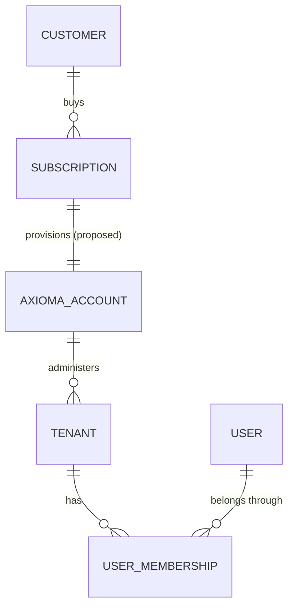

# Axioma Life: Account Service (draft foundations)

> Status: **DRAFT**. Nothing here is decided. Everything marked "Proposed" is a starting point to be
> challenged in the next ticket (GP-4). Axioma Life is fictitious; its purpose is to practice
> multi-tenant SaaS patterns in Go.

## Product context

**Axioma Life** is a fictitious Human Resources and Payroll SaaS for the Mexican market. It is
multi-tenant: many employers use the same platform, with their data isolated from each other.

This document covers only the foundation every other service depends on: who the customers are,
how their organizations (tenants) are modelled, and who can do what. HR and payroll features come
later.

## Core concepts

| Concept | Draft meaning |
|---|---|
| **Customer** | The party that buys a subscription to Axioma Life (the commercial relationship). |
| **Subscription** | What the customer buys: plan, limits, billing state. |
| **AxiomaAccount** | The administrative and billing container created when a customer subscribes. Conceptually similar to an AWS Account: the boundary for ownership, billing and administration. |
| **Tenant** | An isolated HR and payroll workspace; in the product, the employer (legal entity) whose employees are managed. The unit of data isolation. |
| **User** | A person who authenticates. Belongs to tenant(s) and holds roles. |
| **SuperUser** | A privileged user able to create the first tenant(s). Who exactly this is is an open question (see Q4). |

Key idea: one **AxiomaAccount can administer several Tenants** (for example, a group of companies or
an accounting firm managing several clients), and each Tenant acts as the HR and payroll owner.

## Draft relationship model

`USER_MEMBERSHIP` (user + tenant + role) is only a proposal; it allows one person to belong to
several tenants. Whether that is needed is Q3.

## Service boundary

- **Account Service** (customers, subscriptions, accounts, tenants) and **Auth Service** (users,
  credentials, tokens, roles) are closely related.
- Proposed: **one codebase, one deployable (modular monolith)** with a clear logical separation
  (separate packages, no cross-imports of internals). Splitting later should be possible.
- This is a Go practice target: package boundaries with `internal/`, interfaces at the seams.

## Open questions (to resolve in GP-4)

### A. Tenancy model
1. **Data isolation strategy:** shared tables with a `tenant_id` column (optionally Postgres
   Row-Level Security), schema-per-tenant, or database-per-tenant? Trade-offs: cost, isolation,
   migrations, noisy neighbours. Proposed starting point: shared schema + `tenant_id` + RLS.
2. **Tenant resolution:** how does a request say which tenant it targets? Subdomain, path, header, or
   a claim inside the token?

### B. Identity and relationships
3. **Can a user belong to several tenants?** If so, is the user global (account-level identity) or
   per tenant? Impacts login flow, "switch tenant", and the membership table.
4. **Who is the SuperUser?** A platform operator (Axioma staff), the AxiomaAccount owner (customer
   side), or both as different levels? Who creates the *first* tenant and how does onboarding work?
5. **Customer vs Account cardinality:** is it 1:1, or can one customer hold several accounts?
6. **Are users scoped to an account or a tenant?** For example, an account-level admin who manages
   all tenants without being a member of each.

### C. Authentication and authorization
7. **Auth approach:** build our own (password hashing, JWT, refresh tokens) for learning, or use an
   external provider later (for example Cognito, once we reach AWS)? Proposed: build our own first.
8. **Token contents:** which claims (user id, account id, tenant id, roles)? Lifetime and refresh
   strategy? Revocation?
9. **Authorization model:** simple RBAC per tenant, or something richer (permissions, resource-level
   rules)? Role scopes: platform, account, tenant.

### D. Lifecycle and operations
10. **Tenant lifecycle:** create, suspend, reactivate, delete; data retention and what "delete" means.
11. **Subscription effects:** do plans impose limits (number of tenants, users, employees)? Where are
    they enforced?
12. **Audit trail:** who did what, per tenant. Needed from the start?

### E. Mexico-specific and technical
13. **Tenant legal identity:** which employer data lives on the tenant (razón social, RFC, régimen
    fiscal)? Or is that later HR-domain data?
14. **IDs:** UUID (v7?) versus sequential; how they appear in URLs.
15. **API style and framework:** REST with Fiber first (as planned); versioning; error format.

## Process notes

- The Account/Auth Service is a **realistic, spec-driven** project: use GitHub Spec Kit (see GP-4).
  Before that, verify how Spec Kit's branch naming and `specs/` layout fit our workflow in
  `CLAUDE.md`.
- Out of scope for now: HR and payroll features, AWS/CDK deployment, billing integrations.
